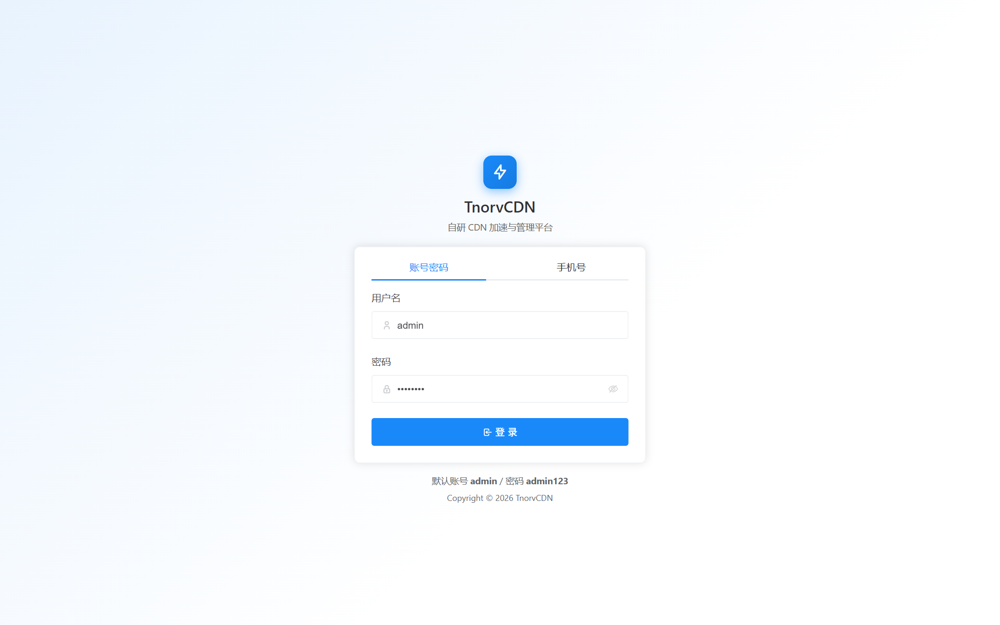
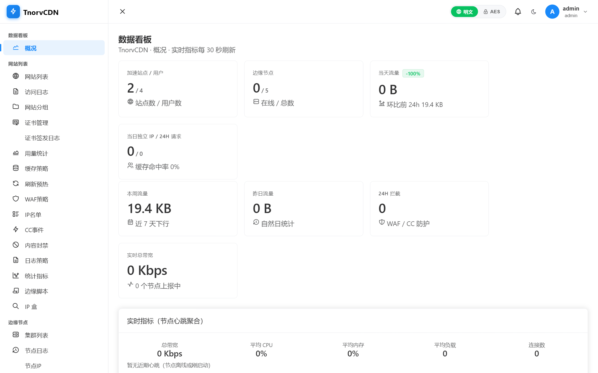
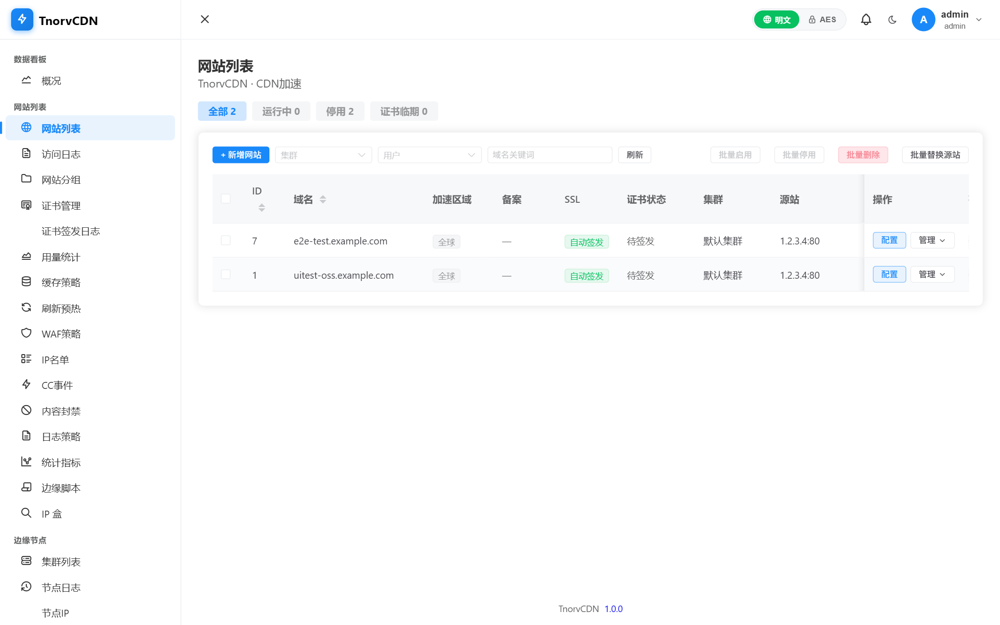
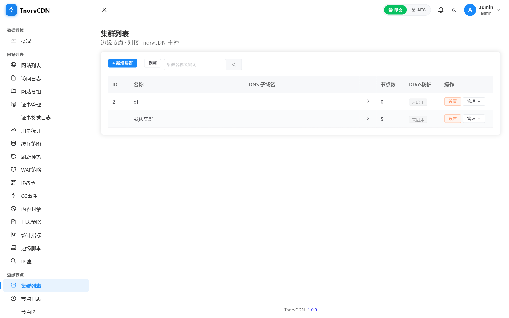
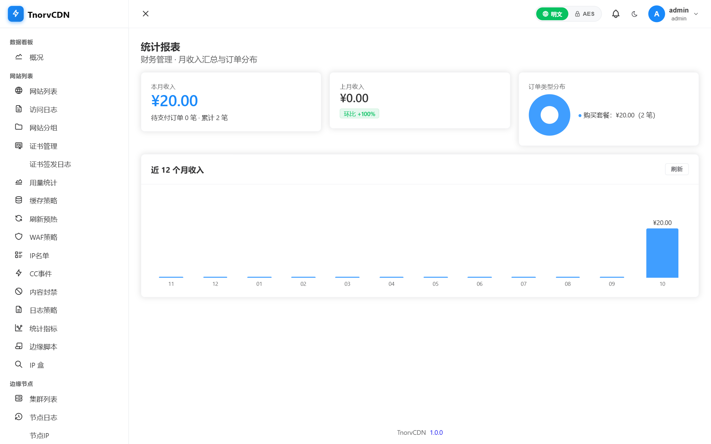
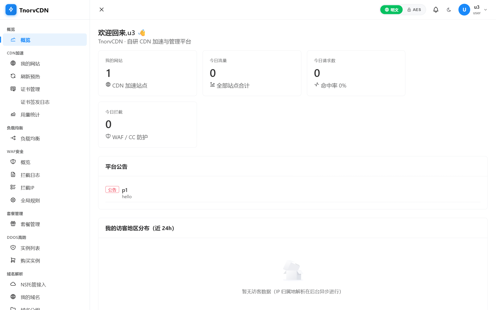
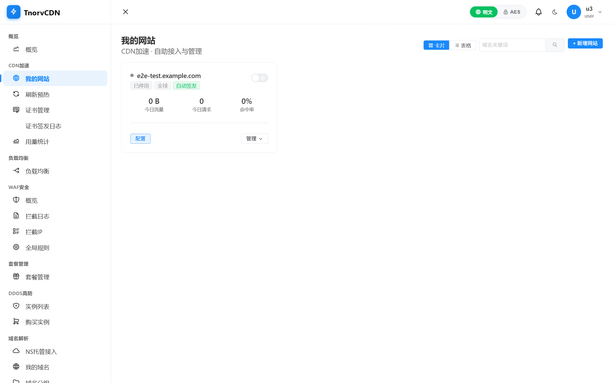
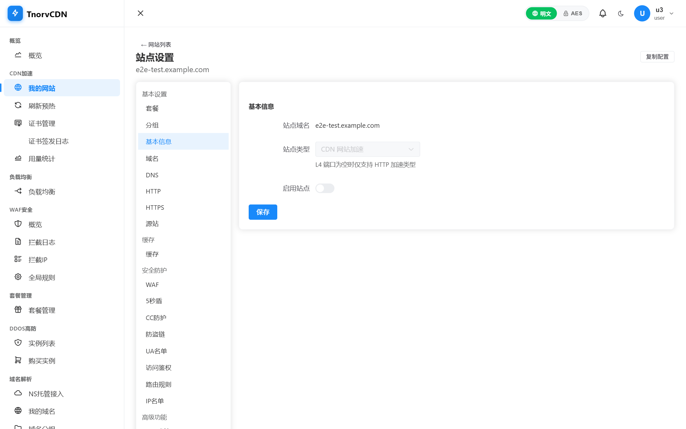
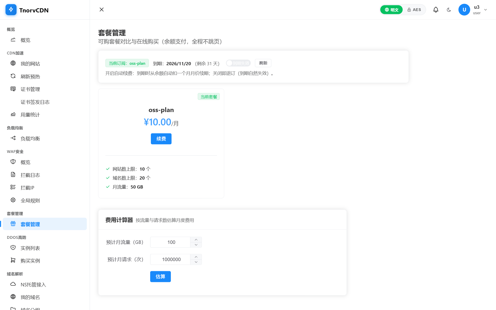

# TnorvCDN

开源的自托管 CDN / 边缘加速系统：.NET 10 主控 + Go 边缘节点 + Vue 3 双控制台（管理员端 / 用户端）。

由 [图诺弗](https://www.tunuofu.com/) 开源维护。如需商业短信 / 语音服务，欢迎了解
[图诺弗通信](https://sms.tnorv.com/)（全球短信、全球语音）。

♥本项目是一个大学生创新创业项目，可以通过tanglangyu@stu.shzu.edu.cn验证归属♥

## 功能总览

- **网站加速**：缓存规则（扩展名/路径/首页/全站）、浏览器端 TTL、回源合并（singleflight）、边缘缓存共享（P2P 拉取）、stale-if-error 兜底、URL/目录/全部缓存刷新
- **安全防护**：WAF 规则、CC 限流（站点级/路由级/每IP每分钟）、IP 黑白名单、5秒盾 JS 挑战、验证码挑战、URL 防盗链（A-D 四种时间戳签名）、AI 语义防护、边缘脚本（expr-lang）
- **高级配置**：URL 跳转/重写、HTTP 报头、访问鉴权（Basic Auth）、请求体大小限制、WebSocket 透传与超时、gRPC 回源、WebP 自适应、字符编码、压缩（gzip/brotli）、多媒体（FLV 直播流透传）
- **HTTPS**：ACME 自动签发（按用户派生邮箱分散账户）+ 手动上传证书，签发事件时间线
- **智能 DNS**：聚合 DNS API / 阿里云 / DNSPod / 华为云 / Cloudflare 解析商对接，NS 托管接入、委派检测、分线路解析
- **运营能力**：多集群（边缘/L2 分层）、节点注册与自升级、套餐与功能矩阵（PlanGate）、流量月结与超额封禁、自定义错误页（404/502/封禁页）、日志与统计（请求/流量/命中率/状态码/地区/排行）
- **用户体系**：用户名/手机号登录、短信验证码（Tnorv SMS 网关协议或自对接）、管理员/普通用户双控制台

## 界面预览

| 登录 | 管理端 · 数据看板 |
|---|---|
|  |  |

| 管理端 · 网站列表 | 管理端 · 集群与边缘节点 |
|---|---|
|  |  |

| 管理端 · 财务统计 | 用户端 · 概览 |
|---|---|
|  |  |

| 用户端 · 我的网站 | 用户端 · 站点设置（27 个配置模块） |
|---|---|
|  |  |

| 用户端 · 套餐与购买 | |
|---|---|
|  | |

## 目录结构

```
src/
  server/TnorvCdn.Api/     主控 API（.NET 10, ASP.NET Core Minimal API + EF Core + PostgreSQL）
  node/                    边缘节点（Go，单二进制，gRPC 拉取配置/上报日志/心跳）
  web/RapidDev.AdminConsole/   管理员控制台（Vue 3 + Element Plus + Vite）
  web/RapidDev.UserConsole/    用户控制台（Vue 3 + Element Plus + Vite）
proto/tnorv.proto          主控↔节点协议定义
```

## 快速开始

> 完整的部署与使用文档（nginx 同源反代、节点接入、证书、缓存/WAF 配置、FAQ）见 **[USAGE.md](USAGE.md)**。

### 1. 主控（.NET 10）

```bash
# 安装 PostgreSQL 与 ASP.NET Core Runtime 10.0
# 修改 src/server/TnorvCdn.Api/appsettings.json：
#   ConnectionStrings:Default —— 数据库连接（Password 占位符请替换）
#   Jwt:Key —— 换成你自己的 ≥32 字节随机密钥
#   Dns —— 按需配置解析商（不使用可留 Enabled=false）
dotnet publish src/server/TnorvCdn.Api -c Release -o publish
ASPNETCORE_URLS=http://0.0.0.0:8080 dotnet publish/TnorvCdn.Api.dll
```

首次启动自动建表，并初始化默认管理员 `admin / admin123` 与默认集群 —— **上线前务必修改密码**。

管理 API：`http://<主控>:8080/api/*`；节点通信：`/grpc/register`、`/grpc/config`、`/grpc/heartbeat`、`/grpc/logs`。

### 2. 边缘节点（Go）

```bash
cd src/node
GOOS=linux GOARCH=amd64 go build -o tnorv-node ./cmd/tnorv-node
# 部署到节点服务器后在管理端「节点管理」创建节点，获得 installToken：
./tnorv-node -c configs/tnorv-node.json   # 配置文件见下
```

节点配置（`configs/tnorv-node.json`）：

```json
{
  "masterUrl": "http://<主控>:8080",
  "installToken": "<管理端创建节点时下发的安装令牌>"
}
```

节点首次启动携带 install_token 调用 `/grpc/register` 自动注册（令牌一次性消耗），随后每 10s 拉取配置快照热更新。缓存刷新、CC 解封等指令随配置快照下发执行。

### 3. 控制台（Vue 3）

```bash
cd src/web/RapidDev.AdminConsole   # 或 RapidDev.UserConsole
npm install
npm run dev     # 开发模式，vite 代理默认指向 http://127.0.0.1:8080（可用 API_PROXY 环境变量覆盖）
npm run build   # 生产构建（dist 交由主控静态托管或任意 Web 服务器）
```

用户控制台 base 为 `/user/`，部署时注意路径。

### 4. 节点自升级（可选）

主控 `appsettings.json` 可配置 `Node:DownloadBaseUrl`（默认 `/downloads`），
作为节点二进制升级包下载地址前缀；也可在升级接口显式传入完整 URL。

## 配置占位符清单

开源版所有凭据均为占位符，部署时必须替换：

| 位置                                 | 占位符               |
| ------------------------------------ | -------------------- |
| `appsettings.json` ConnectionStrings | `<YOUR_DB_PASSWORD>` |
| `appsettings.json` Jwt:Key           | `<CHANGE-ME-...>`    |
| `appsettings.json` Dns.Providers.*   | 空字符串（自行填写） |
| 节点 `masterUrl` / `installToken`    | 运行时传入           |

## 图诺弗通信 · 全球短信 / 全球语音

TnorvCDN 内置的短信能力（验证码、手机号登录、风控提醒）默认对接
[图诺弗通信](https://sms.tnorv.com/) 网关协议，也支持按同一协议自行对接。


- **全球短信**：覆盖 200+ 国家与地区，验证码 / 通知 / 营销，秒级触达，提供送达回执与失败重试
- **全球语音**：语音验证码与语音通知，穿透短信不可达场景
- **企业级稳定**：多通道智能路由、实时用量监控、7×24 技术支持

注册即送试用额度：**[sms.tnorv.com](https://sms.tnorv.com/)** ｜ 官网：**[www.tunuofu.com](https://www.tunuofu.com/)**

## License

Apache License 2.0，见 [LICENSE](LICENSE)。