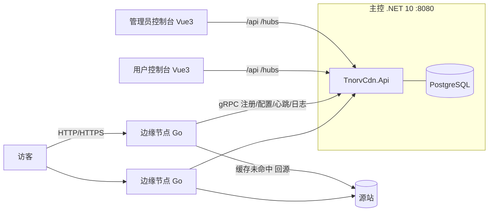

# TnorvCDN 部署与使用指南

本文档面向首次部署的运维 / 开发人员，覆盖从零开始搭建一套完整 TnorvCDN 系统的全过程：
主控 API → 控制台 → 边缘节点 → 接入第一个网站（解析、HTTPS、缓存、防护）。

## 1. 系统架构



| 组件 | 技术栈 | 职责 |
|---|---|---|
| 主控 API | .NET 10 / ASP.NET Core / EF Core | 配置管理、套餐计费、证书签发、节点配置下发与日志汇聚 |
| 边缘节点 | Go（单二进制） | 接收加速流量、缓存、WAF/CC 防护、内建权威 DNS（NS 托管） |
| 管理员控制台 | Vue 3 + Element Plus | 站点/节点/用户/财务/工单运营管理 |
| 用户控制台 | Vue 3 + Element Plus | 用户自助接入、套餐购买、用量与工单 |
| PostgreSQL | 14+ | 唯一持久化存储 |

主控与节点之间通过 gRPC（`proto/tnorv.proto`）通信：节点注册（一次性 installToken）→ 每 10s 拉取配置快照热更新 → 心跳上报 → 访问日志批量上报。

## 2. 环境要求

| 组件 | 版本要求 | 用途 |
|---|---|---|
| PostgreSQL | 14+ | 主控数据库 |
| .NET SDK | 10.0 | 编译主控（运行只需 ASP.NET Core Runtime 10.0） |
| Go | 1.22+ | 编译边缘节点（也可直接下载发行版二进制） |
| Node.js | 18+ | 构建 Vue 控制台 |
| Linux 服务器 | 1 核 2G 起 | 主控 1 台；边缘节点按流量规划，需可开放 80/443 |

## 3. 准备数据库

```sql
CREATE DATABASE tnorv ENCODING 'UTF8';
-- 建议使用独立账号
CREATE USER tnorv WITH PASSWORD '你的强密码';
GRANT ALL PRIVILEGES ON DATABASE tnorv TO tnorv;
```

> 首次启动主控会自动建表并写入初始数据（默认管理员、默认集群），无需手工执行迁移脚本。

## 4. 部署主控 API

### 4.1 修改配置

编辑 `src/server/TnorvCdn.Api/appsettings.json`：

| 配置项 | 说明 |
|---|---|
| `ConnectionStrings:Default` | PostgreSQL 连接串，替换 `<YOUR_DB_PASSWORD>` |
| `Jwt:Key` | JWT 签名密钥，**必须**替换为 ≥32 字节随机串（如 `openssl rand -base64 48` 生成） |
| `Dns:Enabled` | 仅作首次启动种子：是否随启动把该节迁移入 DnsSettings 表（此后以数据库/管理端为准） |
| `Dns:Provider` | `aggregated` / `aliyun` / `dnspod` / `huawei` / `cloudflare` |
| `Dns:DefaultDomainId` | DNS 服务商处主域名 ID（CNAME 与集群 A 记录建在其下） |
| `Dns:Providers.*` | 对应厂商的 API 凭证 |
| `Node:DownloadBaseUrl` | （可选）节点自升级包下载地址前缀，默认 `/downloads` |

### 4.2 发布与启动

```bash
dotnet publish src/server/TnorvCdn.Api -c Release -o /opt/tnorv-master
```

systemd 服务示例 `/etc/systemd/system/tnorv-api.service`：

```ini
[Unit]
Description=TnorvCDN Master API
After=network.target postgresql.service

[Service]
WorkingDirectory=/opt/tnorv-master
ExecStart=/usr/bin/dotnet /opt/tnorv-master/TnorvCdn.Api.dll
Environment=ASPNETCORE_URLS=http://0.0.0.0:8080
Restart=always
RestartSec=3

[Install]
WantedBy=multi-user.target
```

```bash
systemctl daemon-reload && systemctl enable --now tnorv-api
curl -s http://127.0.0.1:8080/api/auth/site-info   # 返回 200 即正常
```

### 4.3 首次安装引导

- 启动时自动建表并初始化「默认集群」；边缘节点与网站都归属集群
- **系统不内置默认账号**：打开管理端（`http://控制台域名/`）会自动进入安装引导：
  ① 环境检测（数据库连接/默认集群）→ ② 设置管理员用户名与密码（≥8 位）→ ③ 完成
  引导仅在库中无任何用户时开放，创建管理员后接口永久关闭（无法被重复利用重置账号）
- 登录管理端后，先到「系统设置 → 基础设置」核对站点信息，再到「系统设置 → ACME 签发账户」按需配置签发邮箱模板（不配置则节点以无邮箱模式向 Let's Encrypt 签发）

## 5. 构建与部署控制台

```bash
cd src/web/RapidDev.AdminConsole    # 管理端
npm install && npm run build        # 产物 dist/

cd ../RapidDev.UserConsole          # 用户端（vite base 为 /user/）
npm install && npm run build
```

控制台与主控**同源部署**（前端请求 `/api/*`、`/hubs/*`），由 nginx 反向代理到主控，避免跨域。
推荐单域名方案，管理端在根路径、用户端挂在 `/user/`：

```nginx
server {
    listen 80;
    server_name console.example.com;

    # 管理端静态资源
    root /var/www/tnorv/admin-dist;
    index index.html;
    location / { try_files $uri $uri/ /index.html; }

    # 用户端（vite base=/user/，注意 alias 结尾斜杠）
    location /user/ {
        alias /var/www/tnorv/user-dist/;
        try_files $uri $uri/ /user/index.html;
    }

    # 主控 API
    location /api/ {
        proxy_pass http://127.0.0.1:8080;
        proxy_set_header Host $host;
        proxy_set_header X-Real-IP $remote_addr;
    }

    # SignalR 实时通道（WebSocket）
    location /hubs/ {
        proxy_pass http://127.0.0.1:8080;
        proxy_http_version 1.1;
        proxy_set_header Upgrade $http_upgrade;
        proxy_set_header Connection "upgrade";
        proxy_read_timeout 300s;
    }
}
```

> 也可以用两个域名分别托管两个控制台，各自保留 `/api/`、`/hubs/` 反代即可。
> 本地开发无需 nginx：`npm run dev` 已内置代理，默认指向 `http://127.0.0.1:8080`，
> 可用 `API_PROXY=http://主控:8080 npm run dev` 覆盖。

## 6. 部署边缘节点

### 6.1 编译 / 获取二进制

```bash
cd src/node
GOOS=linux GOARCH=amd64 go build -o tnorv-node ./cmd/tnorv-node
# 上传到节点服务器，例如 /opt/tnorv/tnorv-node
```

### 6.2 创建节点并获取安装令牌

管理端 →「边缘节点 → 集群列表」→ 目标集群「管理」中新增节点，得到一次性 `installToken`。
令牌仅首次注册消耗，注册成功后节点本地保存长期 `nodeToken`（0600 权限落盘）。

### 6.3 节点配置

`/opt/tnorv/configs/tnorv-node.json`：

```json
{
  "masterUrl": "http://主控IP:8080",
  "installToken": "管理端下发的安装令牌",
  "cacheDir": "/opt/tnorv/cache",
  "memoryCacheMB": 256,
  "logBufferMax": 10000,
  "adminHttpAddr": "127.0.0.1:8081"
}
```

| 字段 | 说明 |
|---|---|
| `masterUrl` | 主控地址，节点需可访问其 8080 端口 |
| `installToken` | 首次注册用，注册成功后自动清除 |
| `cacheDir` | 磁盘缓存目录（建议大容量盘） |
| `memoryCacheMB` | 内存热点缓存上限（MB） |
| `logBufferMax` | 日志本地缓冲条数（断网不丢，恢复后补报） |
| `adminHttpAddr` | 节点本地管理端口（`/health` 健康检查） |

systemd 服务 `/etc/systemd/system/tnorv-node.service`：

```ini
[Unit]
Description=TnorvCDN Edge Node
After=network.target

[Service]
WorkingDirectory=/opt/tnorv
ExecStart=/opt/tnorv/tnorv-node -c /opt/tnorv/configs/tnorv-node.json
Restart=always
RestartSec=3
LimitNOFILE=1048576

[Install]
WantedBy=multi-user.target
```

### 6.4 验证接入

```bash
systemctl enable --now tnorv-node
curl -s http://127.0.0.1:8081/health
```

管理端「集群列表」该节点计数 +1，「节点 IP」页可见在线状态与心跳；节点每 10s 拉取配置快照，
新增网站、缓存、WAF 等配置变更随下次拉取热生效，无需重启节点。

> 节点对外加速端口由网站/集群配置决定（HTTP 80、HTTPS 443 等），记得在防火墙放行；同时保证节点可出站访问主控 8080 与源站。

## 7. 接入第一个网站

1. **分配套餐**：用户需持有有效套餐才能接入网站。管理端「套餐管理」创建套餐（价格、站点数/域名数/月流量上限、功能开关矩阵），用户端「套餐管理 → 余额购买」，或在管理端为用户调整余额。
2. **新增网站**：用户端「我的网站 → + 新增网站」，填写域名、接入方式、加速区域、源站。
   - **CNAME 接入**（默认）：把域名 CNAME 到集群接入子域名，切换节点灵活；
   - **NS 托管接入**：把子域 NS 记录指向系统智能 DNS，解析直接应答节点 IP（无 CNAME 中间层），需在「域名解析 → NS托管接入」登记并检测委派。
3. **完成解析**：在你的 DNS 服务商处按页面提示添加 CNAME（或 NS）记录，等待生效。
4. **开启 HTTPS**：站点设置 → HTTPS，选择「自动签发」即可，解析生效后系统自动向 Let's Encrypt 申请并按期续期；也可选择「手动上传」PEM 证书。
5. **配置缓存**：站点设置 → 缓存，按扩展名/路径/首页/全站添加规则，支持浏览器端 TTL、stale-while-revalidate 等；改版后在「刷新预热」按 URL/目录/域名/全部刷新。
6. **安全防护**（按需）：WAF 规则、CC 限流（站点级/路由级/每 IP 每分钟阈值）、IP 黑白名单、5秒盾、URL 防盗链（时间戳签名）、访问鉴权（Basic Auth）、UA 名单。
7. **验证**：`curl -I http://你的域名/` 应返回源站内容且命中节点；管理端「访问日志」「用量统计」出现实时记录。

## 8. 智能 DNS（可选）

启用三方 DNS 后，系统把网站 CNAME / 集群 A 记录自动同步到你的 DNS 服务商，并支持分线路（电信/联通/移动/境外等）解析到不同节点：

1. DNS 配置**只存数据库**（DnsSettings 表，管理端「DNS服务商」页编辑，保存即生效）。
   `appsettings.json` 的 `Dns` 节仅在首次启动（表中无配置行）时一次性迁移入库，之后修改文件不再生效，一切以管理端为准。
2. 管理端「集群列表」为集群设置 DNS 子域名，「同步解析」可手动触发全量同步。
3. 「解析测试」页向在线节点的内建权威 DNS（:53）发起真实 UDP 查询，验证分线路应答。
4. NS 托管接入见第 7 节，适合把整个子域交给系统接管。

## 9. 短信能力（可选）

管理端「系统设置 → 短信设置」配置网关地址、ApiKey/ApiSecret、签名、单手机日限额与验证码有效期。
配置后可用：注册/登录短信验证码、手机号免密登录、风控提醒。系统默认对接
[Tnorv SMS](https://sms.tnorv.com/) 网关协议，也可按同一协议自行对接；不配置则全站不发送短信。

## 10. 运营管理速查

| 能力 | 入口 |
|---|---|
| 套餐与功能矩阵（控制用户端可用功能） | 管理端「套餐列表」编辑功能开关 |
| 用户余额调整（写审计） | 管理端「用户账户 → 余额调整」 |
| 流量月结 / 超额封禁 | 每日自动结算，「费用账单」查看月结明细 |
| 自定义错误页（404/502/封禁页） | 用户端「站点设置 → 自定义页面」 |
| 节点自升级 | 上传新版本二进制包到 `Node:DownloadBaseUrl`，节点管理中下发升级 |
| 操作/登录审计 | 「日志审计」两个页面 |
| 公告与站内通知 | 「公告管理」「消息中心」 |

## 11. 常见问题

**节点注册成功但不在线？**
检查节点出站能否访问主控 8080（`curl http://主控:8080/api/auth/site-info`）；installToken 是否已被消耗；`masterUrl` 协议（http/https）是否写对。

**HTTPS 自动签发失败？**
域名解析未生效（`dig` 确认 CNAME/A 指向节点）；80/443 未对公网放行（ACME 校验需要）；内部域名/保留后缀会被 CA 拒绝；签发过多被 Let's Encrypt 限流——可在「ACME 签发账户」配置按用户派生的邮箱模板分散账户。

**控制台一直跳回登录页？**
前端与主控必须同源（nginx 已反代 `/api`、`/hubs`）；更换 `Jwt:Key` 后旧令牌全部失效属正常，重新登录即可；多实例部署需保证各实例 `Jwt:Key` 一致。

**网站返回 502？**
源站地址/端口/协议（http/https）填写错误；源站防火墙未放行节点出口 IP；源站本身故障——可在站点「源站」配置多源站容灾。

**缓存不生效？**
站点「页面缓存」总开关未开启；规则不匹配；源站响应带 `Set-Cookie` / `Cache-Control: private` 等不可缓存头；命中状态可在访问日志的缓存列确认。

**主控启动报数据库连接失败？**
确认 PostgreSQL 已启动、连接串主机/端口/密码正确、`tnorv` 库已创建且账号有权限。

## 12. 升级

- **主控**：替换 publish 目录后 `systemctl restart tnorv-api`（数据库结构变更随启动自动处理，建议先备份）。
- **节点**：把新版二进制放到 `Node:DownloadBaseUrl` 下（命名 `tnorv-node-{版本}-linux-amd64`），管理端节点管理中下发升级，节点下载校验后自动替换重启；也可登录节点手工替换二进制后重启服务。
- **控制台**：重新 `npm run build` 并覆盖 nginx 静态目录。

## 13. 安全清单（上线前）

- [ ] 安装引导中已设置自定义管理员账号与强密码（系统不内置默认账号）
- [ ] 替换 `Jwt:Key` 为随机 ≥32 字节
- [ ] 数据库使用强密码；主控 8080 仅监听内网或置于 nginx 之后
- [ ] 节点 `configs/tnorv-node.json` 权限 0600（程序默认即为 0600）
- [ ] 防火墙：仅放行业务端口（80/443），节点本地管理端口绑定 127.0.0.1
- [ ] 定期下载「基础设置 → 数据备份」的全库备份并离线保存
